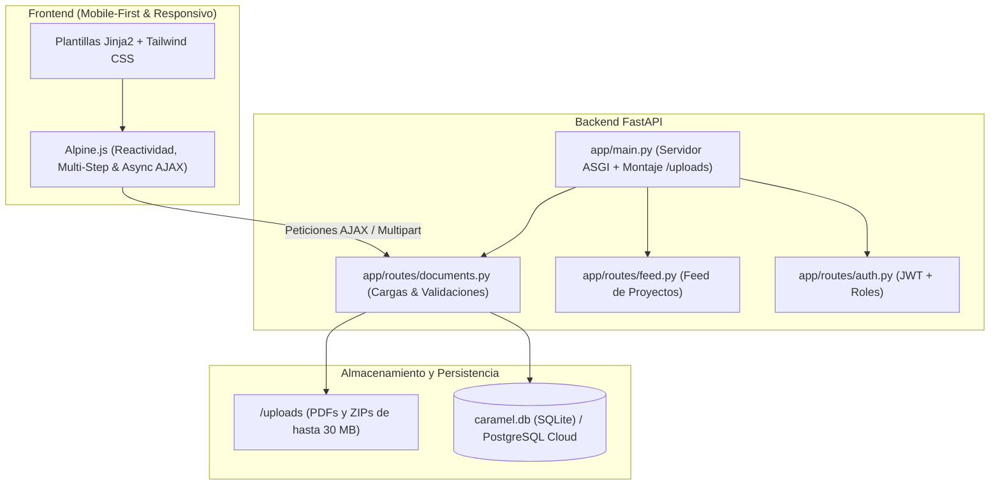
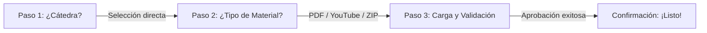

# 🧭 BLUEPRINT TÉCNICO MAESTRO: PROYECTO CARAMEL
**Plataforma Web Colaborativa para la Gestión del Capital Intelectual en el Eje de Programación**  
*Universidad de Margarita (UNIMAR) • Decanato de Ingeniería y Afines*  
*Trabajo Especial de Grado — Oscar Álvarez*

---

## 📌 Índice de Contenidos
1. [Visión General de la Arquitectura](#1-visión-general-de-la-arquitectura)
2. [Flujo de Aportaciones Multi-Step (Recuperado al 100%)](#2-flujo-de-aportaciones-multi-step)
3. [Motor de Validación Inteligente de YouTube y Duplicados](#3-motor-de-validación-inteligente-de-youtube)
4. [Gestión de Archivos y Almacenamiento Local (Límite 30 MB)](#4-gestión-de-archivos-y-almacenamiento-local)
5. [Diccionario de Rutas y Endpoints Clave](#5-diccionario-de-rutas-y-endpoints-clave)
6. [Modelo de Datos y Persistencia (SQLite / PostgreSQL)](#6-modelo-de-datos-y-persistencia)
7. [Guía de Ejecución: Linux vs Windows](#7-guía-de-ejecución-linux-vs-windows)
8. [Protocolo de Respaldo Seguro (Git / GitHub)](#8-protocolo-de-respaldo-seguro)

---

## 1. Visión General de la Arquitectura



---

## 2. Flujo de Aportaciones Multi-Step

El formulario de aportes (`upload_material.html`) sigue la filosofía **"ONE QUESTION AT A TIME"**, garantizando que el estudiante complete el registro sin sobrecarga cognitiva.



### 📍 Paso 1 de 3: Selección de Cátedra (Pensum del Eje de Programación)
* **Pregunta:** `¿Para qué cátedra está destinado tu contenido?`
* **Catálogo Oficial Acotado:** Se restringe rigurosamente al eje académico de desarrollo y software de UNIMAR (7 asignaturas):
  1. `Programación I` (1º Trimestre)
  2. `Programación II` (2º Trimestre)
  3. `Programación III` (3º Trimestre)
  4. `Programación IV` (4º Trimestre)
  5. `Estructura de Datos` (3º Trimestre)
  6. `Bases de Datos I` (4º Trimestre)
  7. `Bases de Datos II` (5º Trimestre)
* **Botones Principales en Pantalla (2 arriba, 1 centrado abajo):**
  * Inicialmente: `Programación III`, `Programación IV` y `Bases de Datos I`.
  * **Interacción Smooth de Reemplazo (`⇄`):** Cada botón cuenta con un icono interactivo que abre un panel flotante (*drawer/modal*) con búsqueda en tiempo real. El estudiante puede buscar cualquier otra asignatura de las 7 y sustituir el botón en caliente con una transición suave.
* **Comportamiento:** Al pulsar la materia deseada, se selecciona con respuesta háptica/visual y avanza automáticamente al Paso 2.

### 📍 Paso 2 de 3: Selección del Tipo de Material
* **Pregunta:** `¿Qué tipo de material es el que deseas subir?`
* **Opciones en píldoras interactivas:**
  1. `📄 PDF` (Libros, resúmenes o guías de laboratorio).
  2. `🎥 Link de YouTube` (Clases magistrales, conferencias o tutoriales).
  3. `📦 ZIP de proyecto` (Código fuente completo empaquetado).
* **Navegación:** Permite regresar al Paso 1 con el botón `← Cambiar de cátedra` o haciendo clic en el Punto 1.

### 📍 Paso 3 de 3: Vistas Dinámicas Especializadas (Ultra-Minimalista)
> **Principio de Diseño:** Siguiendo la premisa *"ONE QUESTION AT A TIME"*, se eliminaron completamente las casillas manuales de título y aportador.  
> * **Título Automático:** El material toma como título el nombre de la cátedra seleccionada. El profesor asignará el área o tema específico del plan de evaluación durante la revisión en el panel docente.  
> * **Aportador Automático:** Se asocia de manera transparente desde la sesión institucional activa del usuario.

* **Caso YouTube (`materialType === 'video'`):**
  * Título: `Pega aquí tu link de YouTube para: [Cátedra Seleccionada]`
  * Campo único con ícono de YouTube y formato: `https://www.youtube.com/watch?v=...`
  * Loader reactivo:
    > *⌛ Consultando base de datos docente... Verificando que este enlace no haya sido aportado anteriormente...*
  * Alerta de duplicado en caso de existir en BD:
    > *⚠️ ¡El video que intentas aprobar ya fue validado anteriormente, más atento Casi Ingeniero!*
  * Botón: `Enviar para primer review`
* **Caso PDF (`materialType === 'pdf'`):**
  * Encabezado: `Arroja aquí tu contenido de PDF para: [Cátedra Seleccionada]`
  * Dropzone (arrastrar/soltar o seleccionar archivo) con límite explícito de **30 MB** y previsualización con checkmark verde.
  * Validación instantánea de tipo MIME y peso.
  * Botón: `Enviar para primer review`
* **Caso ZIP (`materialType === 'zip'`):**
  * Encabezado: `Arroja aquí tu contenido ZIP para: [Cátedra Seleccionada]`
  * Dropzone con medidor dinámico de peso en MB y límite de **30 MB**.
  * Validación de extensión `.zip` y tamaño máximo.
  * Botón: `Enviar para primer review`

### 📍 Pantalla de Éxito / Confirmación
* Los 3 puntos cambian a color verde esmeralda.
* Círculo verde grande con animación de checkmark (`✓`).
* Mensaje pedagógico:
  > *"¡Listo! Un profesor estará revisando tu contenido para determinar si es útil para su primer review."*
* Agradecimiento institucional: *"¡Muchas gracias Oscar Álvarez!"*
* Acciones: `Subir otro material` (resetea al Paso 1) y `Volver al Inicio` (redirige a `/`).

---

## 3. Motor de Validación Inteligente de YouTube

Implementado en [`app/routes/documents.py`](file:///C:/Users/Admin/Downloads/Caramel/Caramel-main/app/routes/documents.py):

```python
def extract_youtube_id(url: str | None) -> str | None:
    """Extrae el ID único de 11 caracteres de cualquier URL de YouTube."""
    if not url:
        return None
    patterns = [
        r'(?:https?:\/\/)?(?:www\.)?youtube\.com\/watch\?(?:.*&)?v=([a-zA-Z0-9_-]{11})',
        r'(?:https?:\/\/)?(?:www\.)?youtu\.be\/([a-zA-Z0-9_-]{11})',
        r'(?:https?:\/\/)?(?:www\.)?youtube\.com\/embed\/([a-zA-Z0-9_-]{11})',
        r'(?:https?:\/\/)?(?:www\.)?youtube\.com\/shorts\/([a-zA-Z0-9_-]{11})',
    ]
    for pattern in patterns:
        match = re.search(pattern, url)
        if match:
            return match.group(1)
    return None
```

* **Prevención de Duplicados:** Antes de registrar el documento, el endpoint `POST /api/check-youtube-duplicate` verifica si el ID ya existe en las columnas `external_url` o `read_url` de la tabla `documents`.
* **Portada en Alta Definición:** Al aprobarse un enlace, el sistema asigna automáticamente la miniatura oficial en HD: `https://img.youtube.com/vi/{youtube_id}/hqdefault.jpg`.

---

## 4. Gestión de Archivos y Almacenamiento Local

* **Directorio de Almacenamiento:** `Caramel-main/uploads/` (creado automáticamente al iniciar el servidor).
* **Montaje en FastAPI:**
  ```python
  uploads_dir = os.path.join(os.path.dirname(os.path.dirname(__file__)), "uploads")
  os.makedirs(uploads_dir, exist_ok=True)
  app.mount("/uploads", StaticFiles(directory=uploads_dir), name="uploads")
  ```
* **Nombres Sanitizados y Criptográficamente Únicos:**  
  Se aplica un prefijo `uuid.uuid4().hex[:10]` junto al nombre seguro del archivo para evitar colisiones.
* **Límite Estricto de 30 MB:**
  * En cliente: verificación inmediata con Alpine.js mediante `file.size / (1024 * 1024) > 30`.
  * En servidor: control de buffer en `upload_material_submit` que retorna código `400 Bad Request` si la carga sobrepasa el límite.

---

## 5. Diccionario de Rutas y Endpoints Clave

| Método | Ruta | Propósito | Formato / Respuesta |
| :--- | :--- | :--- | :--- |
| `GET` | `/upload-material` | Renderiza el formulario paso a paso | HTML (`upload_material.html`) |
| `POST` | `/upload-material` | Procesa la carga (Multipart/AJAX) | JSON `{ success, doc_id }` o HTML |
| `POST` | `/api/check-youtube-duplicate` | Verifica si el video de YouTube ya existe | JSON `{ valid, duplicate, message }` |
| `GET` | `/validation-panel` | Panel de revisión para docentes | HTML (`validation_panel.html`) |
| `POST` | `/document/{id}/validate` | Aprueba o rechaza un recurso propuesto | Redirección 303 |
| `GET` | `/document/{id}` | Vista detallada del recurso (lector/video) | HTML (`document_detail.html`) |

---

## 6. Modelo de Datos y Persistencia

### Modelo `Document` (`app/models.py`)
* `id`: Identificador entero autoincremental.
* `title`: Título formal catalogado bajo Dublin Core.
* `authors`: Autor del libro, expositor del video o estudiante creador.
* `materias`: Cátedra del eje de programación asignada.
* `material_type`: `'pdf'`, `'video'`, `'zip'`, `'libro'`, `'guia'`.
* `read_url` / `external_url`: Ruta interna (`/uploads/...`) o externa (`https://youtube...`).
* `cover_url`: Portada ilustrativa o miniatura de YouTube en HD.
* `status`: Estado del recurso (`'pendiente'`, `'aprobado'`, `'rechazado'`).
* `uploaded_by_id`: Foreign Key al usuario creador (`users.id`).

---

## 7. Guía de Ejecución: Linux vs Windows

### 🐧 En Linux (Arch Linux, Ubuntu, etc.)
El script tradicional sigue funcionando exactamente igual:
```bash
chmod +x run.sh
./run.sh
# O si tienes el comando alias global configurado:
caramel
```

### 🪟 En Windows (Tu entorno actual)
Tienes dos opciones nativas listas para usar sin necesidad de bash:

#### Opción A: Mediante doble clic o CMD
Ejecuta el archivo [run.bat](file:///C:/Users/Admin/Downloads/Caramel/Caramel-main/run.bat):
```cmd
run.bat
```

#### Opción B: Mediante PowerShell
Ejecuta el archivo [run.ps1](file:///C:/Users/Admin/Downloads/Caramel/Caramel-main/run.ps1):
```powershell
powershell -ExecutionPolicy Bypass -File .\run.ps1
```

> [!TIP]
> Ambos scripts verifican si existe un entorno virtual `venv`, seleccionan el intérprete adecuado, arrancan el servidor en el puerto **8001** y abren automáticamente el navegador en `http://localhost:8001/login`.

---

## 8. Protocolo de Respaldo Seguro (Git / GitHub)

Para evitar pérdidas futuras, el proyecto ya cuenta con su repositorio Git local inicializado con el commit de recuperación:

```bash
# 1. Ver el estado de tus archivos
git status

# 2. Agregar los cambios realizados
git add .

# 3. Guardar el punto de restauración con un mensaje claro
git commit -m "feat: formulario multi-step y validaciones completadas"

# 4. Vincular tu repositorio de GitHub (si aún no está configurado)
git remote add origin https://github.com/TU_USUARIO/Caramel.git

# 5. Respaldar en la nube
git push -u origin master
```

Además, cuentas con la copia física comprimida lista para llevar:  
📦 [Caramel-RECUPERADO.zip](file:///C:/Users/Admin/Downloads/Caramel/Caramel-RECUPERADO.zip)
