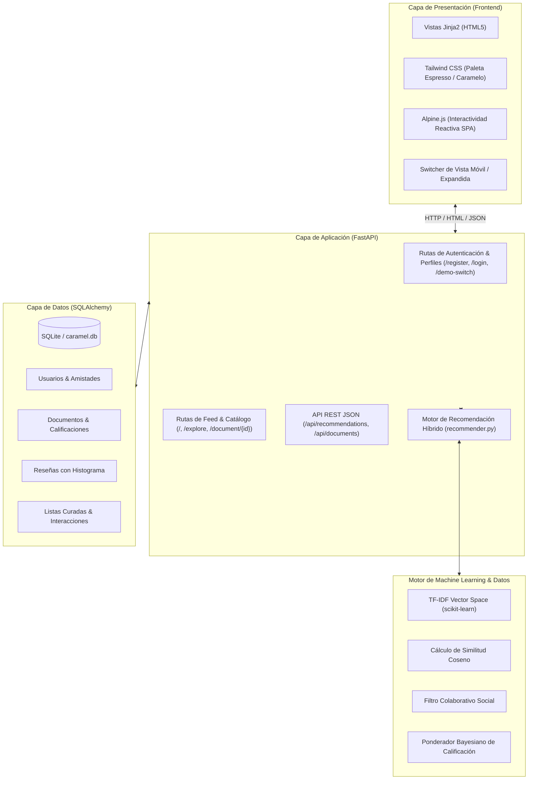

# 🍮 Caramel: Plataforma de Recomendación de Documentos Académicos
**Tipo de Proyecto:** Plataforma Web & Motor de Recomendación Inteligente (Hybrid AI)  
**Prototipo Figma Base:** [Caramel Prototype (Figma)](https://www.figma.com/proto/HENzhk9zdmNOt8vP13dkxQ/Caramel-Prototype?node-id=36-21)  
**Arquitectura:** Monolito Reactivo en Python (FastAPI + Jinja2 + Tailwind CSS + Alpine.js + Scikit-Learn)  
**Base de Datos:** SQLite / SQLAlchemy ORM  
**Fecha:** Septiembre 2026  

---

## 📋 1. Resumen Ejecutivo del Proyecto

**Caramel** es una plataforma web universitaria diseñada para optimizar el descubrimiento y consumo de material bibliográfico y documentos académicos (libros canónicos, guías de ejercicios, papers y apuntes de cátedra).

La plataforma resuelve el problema de la sobrecarga de información y la dispersión bibliográfica universitaria mediante un **motor de recomendación híbrido de cuatro etapas** que personaliza el catálogo en tiempo real según la carrera del estudiante, su trimestre en curso, las opiniones de su red de amigos y la similitud semántica con sus lecturas previas.

Toda la experiencia de usuario y diseño visual reproduce fielmente el prototipo móvil desarrollado en Figma, caracterizado por su estética cálida en tonos café espresso y caramelo (`#181310`, `#C6864D`), tarjetas con bordes suaves, carruseles fluidos y un histograma de calificaciones escalonado de 5 estrellas.

---

## 🎯 2. Objetivos Principales

1. **Replicación Fiel del Diseño (Pixel-Perfect):** Trasladar la identidad visual, paleta cromática, tipografías y componentes interactivos del prototipo de Figma a una aplicación web responsiva de alto rendimiento.
2. **Recomendación Contextual Inteligente:** Eliminar la necesidad de búsquedas manuales tediosas; el sistema presenta inmediatamente los documentos idóneos para el trimestre actual del alumno.
3. **Validación Social entre Pares:** Integrar la actividad de los amigos universitarios (reseñas, lecturas compartidas y calificaciones) como factor multiplicador de confianza en las recomendaciones.
4. **Explicabilidad Transparente (Explainable AI):** Justificar ante el usuario el motivo exacto por el cual cada documento le es sugerido (ej. *"Clave para tu 3º Trimestre de Ingeniería de Sistemas"*, *"94% de afinidad con tus temas de estudio"*).

---

## 🏗️ 3. Arquitectura del Sistema



---

## 🧠 4. Formulación Matemática del Algoritmo de Recomendación

El motor de recomendación implementado en `app/recommender.py` genera un **Score de Afinidad Compuesto** normalizado de $0\%$ a $100\%$ mediante una combinación lineal ponderada:

$$\text{Score} = (w_1 \cdot S_{\text{acad}}) + (w_2 \cdot S_{\text{social}}) + (w_3 \cdot S_{\text{content}}) + (w_4 \cdot S_{\text{bayes}})$$

Donde los pesos configurados son:
* $w_1 = 0.35$ (Afinidad Curricular / Académica)
* $w_2 = 0.25$ (Afinidad Colaborativa Social)
* $w_3 = 0.25$ (Similitud de Contenido TF-IDF)
* $w_4 = 0.15$ (Calidad Bayesiana Suavizada)

$$\sum_{i=1}^4 w_i = 1.00$$

---

### 4.1. Afinidad Académica Curricular ($S_{\text{acad}}$)
Evalúa la pertenencia del documento al pensum de la carrera y el nivel actual del estudiante:

$$S_{\text{acad}} = \min\left(1.0,\; \delta_{\text{carrera}} \cdot 0.55 + \delta_{\text{trimestre}} \cdot 0.45\right)$$

* $\delta_{\text{carrera}} = 1$ si la carrera del usuario está listada en los programas académicos del documento; de lo contrario $0$.
* $\delta_{\text{trimestre}} = 1.0$ si el trimestre cursado es idéntico a los trimestres recomendados del documento; $0.55$ si es un trimestre contiguo ($\pm 1$); $0$ en otro caso.

### 4.2. Afinidad Colaborativa y Social ($S_{\text{social}}$)
Mide el impacto de la red de amigos y la cohorte universitaria:

$$S_{\text{social}} = \begin{cases} 
\min\left(1.0,\; 0.40 + 0.20 \cdot N_{\text{amigos\_positivos}}\right) & \text{si existen lecturas de amigos} \\
\min\left(0.70,\; 0.20 + 0.15 \cdot N_{\text{cohorte}}\right) & \text{en ausencia de amigos directos} \\
0.0 & \text{si no hay interacciones previas}
\end{cases}$$

### 4.3. Similitud Semántica Basada en Contenido ($S_{\text{content}}$)
Construye vectores TF-IDF en un espacio de características $n$-gramas $(1, 2)$ sobre el corpus textual del documento (título, materias, sinopsis y etiquetas descriptivas):

$$S_{\text{content}} = \cos(\vec{u}_{\text{interes}}, \vec{d}_k) = \frac{\vec{u}_{\text{interes}} \cdot \vec{d}_k}{\|\vec{u}_{\text{interes}}\| \|\vec{d}_k\|}$$

El vector del usuario $\vec{u}_{\text{interes}}$ se alimenta de los documentos que el alumno ha calificado con $\ge 4\star$, guardado en favoritos o consultado en el visor.

### 4.4. Calidad Bayesiana Ponderada ($S_{\text{bayes}}$)
Evita la distorsión producida por libros con una sola calificación perfecta frente a obras con decenas de valoraciones consistentes:

$$WR = \frac{v}{v + m} \cdot R + \frac{m}{v + m} \cdot C$$

$$S_{\text{bayes}} = \frac{WR}{5.0}$$

* $v$: Número de valoraciones recibidas por el documento.
* $m = 3.0$: Umbral mínimo de confianza bayesiana.
* $R$: Calificación promedio del documento.
* $C$: Calificación media global de todo el catálogo universitario.

---

## 📱 5. Catálogo de Pantallas Replicadas de Figma

| Pantalla Figma | Ruta | Funcionalidades Principales |
| :--- | :--- | :--- |
| **1. Regístrate / Iniciar Sesión** | `/register` <br> `/login` | Captura de Carrera, Trimestre, Correo institucional y credenciales. Collage fotográfico universitario superior, logo dorado Caramel y botón de prueba rápida con 1 clic. |
| **2. Feed / Dashboard Principal** | `/` | Saludo dinámico (*"Hola, Oscar!"*), insignia de carrera (*Sistemas • 3º Tri*), buscador interactivo, carrusel *"Populares en este trimestre"*, stacks curados *"Listas que podrían servirte"*, recomendaciones del motor IA y feed social *"Reviews recientes de tus amigos"*. |
| **3. Detalle de Documento** | `/document/{id}` | Portada en relieve, banner hero, metadatos bibliográficos, botones de acción (*Leer*, *Guardar*, *Calificar*), **histograma de 5 estrellas escalonado**, avatares de *"Varios de tus amigos lo han leído"* y lista completa de reseñas. |
| **4. Laboratorio del Algoritmo** | `/recommender-lab` | Panel técnico interactivo para auditar el funcionamiento matemático del motor, con desglose de porcentajes por factor para cada documento del catálogo. |
| **5. Explorador & Catálogo** | `/explore` | Búsqueda por palabras clave, filtro por carreras y navegación por materias. |
| **6. Perfil del Estudiante** | `/profile` | Resumen de credenciales académicas, contador de libros guardados, historial de reseñas redactadas y lecturas registradas. |

---

## 👥 6. Perfiles de Prueba Pre-cargados

El sistema incluye perfiles representativos para validar el comportamiento del recomendador:

1. **Oscar Rodríguez (ID: 1):** Ingeniería de Sistemas • 3er Trimestre *(Usuario principal)*
2. **Carlos Mendoza (ID: 2):** Ingeniería de Sistemas • 4to Trimestre
3. **Valentina Castro (ID: 3):** Ingeniería de Sistemas • 3er Trimestre
4. **Andrés Morales (ID: 4):** Computación • 3er Trimestre
5. **Sofía Paredes (ID: 5):** Ingeniería de Sistemas • 2do Trimestre
6. **David Silva (ID: 6):** Ingeniería Civil • 4to Trimestre

---

## 📡 7. Especificación de Endpoints (API REST)

| Método | Endpoint | Parámetros | Descripción |
| :--- | :--- | :--- | :--- |
| `GET` | `/` | — | Renderiza el feed principal con carruseles y recomendaciones personalizadas. |
| `GET` | `/document/{id}` | `id` (int) | Detalle del documento, histograma de estrellas y reseñas. |
| `POST` | `/document/{id}/review` | `rating` (1-5), `content` (str) | Publica una reseña y actualiza el modelo en tiempo real. |
| `POST` | `/document/{id}/bookmark` | `id` (int) | Alterna el guardado del libro en la biblioteca del usuario. |
| `GET` | `/explore` | `q`, `carrera`, `trimestre` | Búsqueda y filtrado del catálogo académico. |
| `GET` | `/recommender-lab` | — | Vista del simulador con desglose matemático. |
| `GET` | `/demo-switch/{id}` | `id` (int) | Cambia instantáneamente de usuario activo para pruebas. |
| `GET` | `/api/recommendations` | `user_id`, `limit` | API JSON con el cálculo del ranking híbrido y explicabilidad. |
| `GET` | `/api/documents` | — | Listado completo de documentos en formato JSON. |
| `GET` | `/docs` | — | Documentación interactiva Swagger / OpenAPI. |

---

## 💻 8. Guía de Ejecución y Mantenimiento

### 8.1. Puesta en Marcha
```bash
cd /home/oscar/Proyectos/Caramel
./run.sh
```

El script `./run.sh` se encarga automáticamente de:
1. Verificar si el puerto configurado (por defecto 8001) está ocupado y liberarlo de forma segura.
2. Activar el entorno virtual `venv`.
3. Iniciar Uvicorn con recarga en caliente (*hot reload*).

### 8.2. Variables de Entorno y Configuración
* Para cambiar el puerto de ejecución:
  ```bash
  PORT=8080 ./run.sh
  ```
* Base de datos SQLite generada localmente en: `caramel.db`.

---

## 📈 9. Roadmap y Próximas Mejoras Sugeridas

- [ ] **Visor PDF Real:** Integración con PDF.js para lectura completa de libros en el navegador.
- [ ] **Anotaciones y Marcadores Compartidos:** Permitir a los estudiantes subrayar capítulos y compartir apuntes de margen con sus compañeros.
- [ ] **Embeddings Neuronales:** Migración opcional de TF-IDF a modelos vectoriales tipo *Sentence-Transformers* para comprensión semántica profunda de abstracts y artículos científicos.
- [ ] **Integración con Repositorios Universitarios:** Conexión vía protocolo OAI-PMH con bibliotecas digitales de universidades.
